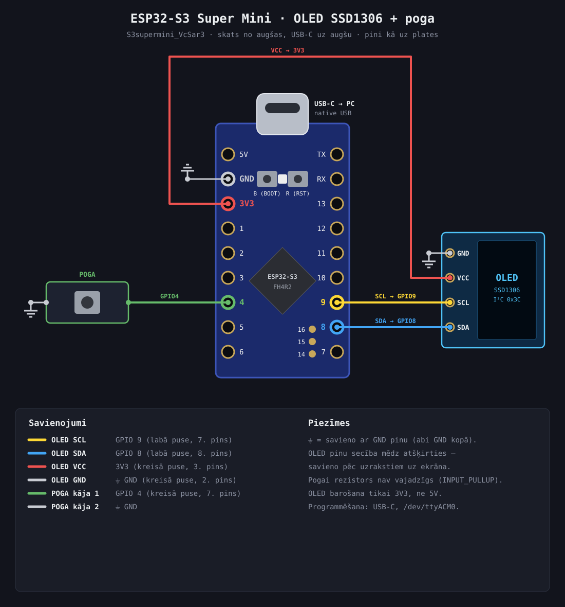

# S3supermini_VcSar3: vilcienu saraksts Melluži → Rīga (V3)

Mazs, patstāvīgs galda ekrāns uz **ESP32-S3 Super Mini** ar 0,96" OLED. Tas
pats lejupielādē Vivi GTFS vilcienu sarakstu un reāllaika kavējumus, rāda
nākamos vilcienus Melluži → Rīga un ar animētu cilvēciņu parāda, vai vēl
var atpūsties vai jau jāskrien uz staciju.

Dators vai serveris nav vajadzīgs, tikai Wi-Fi.



## Saturs

- [Iespējas](#iespējas)
- [Detaļas](#detaļas)
- [Pieslēgums](#pieslēgums)
- [Būvēšana un ielāde](#būvēšana-un-ielāde)
- [Pirmā palaišana un Wi-Fi](#pirmā-palaišana-un-wi-fi)
- [Lietošana](#lietošana)
- [Tīmekļa lapa](#tīmekļa-lapa)
- [Kā tas strādā](#kā-tas-strādā)
- [Ierobežojumi](#ierobežojumi)
- [Faili](#faili)
- [Izcelsme](#izcelsme)

## Iespējas

- Nākamie vilcieni Melluži → Rīga (atiešana un pienākšana) un lielā atskaite
  līdz nākamajam vilcienam.
- **V3 kustības ceļvedis**: animēts cilvēciņš un uzraksts atkarībā no tā, cik
  laika palicis līdz vilcienam (sk. tabulu zemāk).
- Reāllaika kavējumi (GTFS-Realtime) ik pēc 2 minūtēm.
- Poga: nākamo vilcienu saraksts pa 3 vienā lapā.
- **Divi Wi-Fi tīkli**: startējot ESP automātiski izvēlas to, kuram ir
  spēcīgāks signāls. Ar pogu izvēli var mainīt.
- Tīmekļa lapa iestatījumiem: uzraksti, simulēts laiks, laiku aizvietošana un
  Wi-Fi tīkli.

### V3 stāvokļi

| Līdz vilcienam | Uzraksts | Animācija |
|---|---|---|
| ≥ 24 min | VAR ATPUSTIES | sēž |
| 22–24 min | LIEK SOMU | māj ardievas |
| 14–22 min | EJ UZ STACIJU | iet |
| 11–14 min | JASKRIEN | skrien |
| 5–11 min | BRAUC AR AUTO | auto |
| < 5 min | VILCIENS AIZBRAUC | māj ardievas |

Robežas ir `V3DepartureGuide.h` funkcijā `departureGuideState()`.

## Detaļas

| Detaļa | Piezīmes |
|---|---|
| ESP32-S3 Super Mini | Čips `ESP32-S3FH4R2`: 4 MB flash, 2 MB PSRAM, viens USB-C (native USB) |
| OLED SSD1306 128×64, I²C | Adrese `0x3C`, barošana 3,3 V |
| Taustiņš (tactile button) | Jebkurš divkāju vai četrkāju, rezistors nav vajadzīgs |
| USB-C kabelis **ar datu vadiem** | Tikai uzlādes kabeļi neder: dators plati neredzēs |

### Super Mini pini

USB-C uz augšu, pini no augšas uz leju:

- **kreisā puse:** 5V, GND, 3V3, 1, 2, 3, 4, 5, 6
- **labā puse:** TX, RX, 13, 12, 11, 10, 9, 8, 7
- plates apakšā iekšpusē: 16, 15, 14
- pogas: `B` = BOOT, `R` = RST

## Pieslēgums

Shēma: [`S3supermini_shema.svg`](S3supermini_shema.svg).

| Ko | Kur uz Super Mini |
|---|---|
| OLED SDA | GPIO 8 (labā puse, 8. pins) |
| OLED SCL | GPIO 9 (labā puse, 7. pins) |
| OLED VCC | 3V3 (kreisā puse, 3. pins) |
| OLED GND | GND (kreisā puse, 2. pins) |
| Poga, viena kāja | GPIO 4 (kreisā puse, 7. pins) |
| Poga, otra kāja | GND |

- OLED baro tikai no **3V3**, ne no 5V.
- Dažiem OLED moduļiem pinu secība atšķiras (GND/VCC samainīti). Savieno pēc
  uzrakstiem uz ekrāna, nevis pēc vietas.
- Poga izmanto `INPUT_PULLUP`: nenospiesta = HIGH, nospiesta = LOW.
- Ja OLED nav pieslēgts vai neatbild adresē `0x3C`, programma apstājas pašā
  sākumā (`display.begin` neizdodas).

## Būvēšana un ielāde

### Rīki

- [Arduino CLI](https://arduino.github.io/arduino-cli/) (pārbaudīts ar 1.5.1)
- ESP32 Arduino core `esp32:esp32` **3.3.11**
- Bibliotēkas: Adafruit SSD1306 (2.5.17), Adafruit GFX (1.12.6),
  Adafruit BusIO (1.17.4), WiFiManager (2.0.17), unzipLIB (1.0.0)

```bash
arduino-cli core install esp32:esp32@3.3.11
arduino-cli lib install "Adafruit SSD1306" "Adafruit GFX Library" "WiFiManager" "unzipLIB"
```

### Kompilēšana un ielāde

Komandas palaiž no mapes, kurā atrodas `S3supermini_VcSar3` mape:

```bash
FQBN='esp32:esp32:esp32s3:USBMode=hwcdc,CDCOnBoot=cdc,FlashSize=4M,PartitionScheme=noota_ffat'
arduino-cli compile --fqbn "$FQBN" --output-dir build/S3supermini_VcSar3 S3supermini_VcSar3
arduino-cli upload  --fqbn "$FQBN" --port /dev/ttyACM0 \
  --input-dir build/S3supermini_VcSar3 S3supermini_VcSar3
```

| FQBN iestatījums | Kāpēc |
|---|---|
| `FlashSize=4M` | Super Mini ir 4 MB flash |
| `PartitionScheme=noota_ffat` | 2 MB programmai (izmanto ~1,26 MB, 60%), ~1,9 MB FFat GTFS kešam. Bez OTA |
| `USBMode=hwcdc`, `CDCOnBoot=cdc` | `Serial` iet caur USB-C (`/dev/ttyACM0`, `303a:1001`) |

Ja ielāde neizdodas ar "No serial data received": **turi `B`, nospied un
atlaid `R`, atlaid `B`**, tad palaid `upload` vēlreiz.

Seriālā izvade: `arduino-cli monitor -p /dev/ttyACM0 -c baudrate=115200`.

## Pirmā palaišana un Wi-Fi

1. Pirmajā palaišanā neviens tīkls nav saglabāts, tāpēc ESP izveido Wi-Fi
   piekļuves punktu **`Melluzi-Standalone`** (OLED rāda "AP Melluzi-Standalone").
2. Pieslēdzies tam ar telefonu. Ja lapa neatveras pati, atver `http://192.168.4.1`.
3. Izvēlies savu Wi-Fi un ievadi paroli. ESP to saglabā kā **Wi-Fi 1**.
4. Pēc pieslēgšanās OLED **5 sekundes** rāda tīklu un ESP adresi, piem.
   `MajasWiFi 192.168.0.57`.
5. Otro tīklu pievieno ESP [tīmekļa lapā](#tīmekļa-lapa), sadaļā **Wi-Fi 2**.
   Telefonam jābūt tajā pašā tīklā, kurā ir ESP.

Portāls `Melluzi-Standalone` parādās **tikai tad**, kad ESP nevar pieslēgties
nevienam saglabātajam tīklam. Portāls ir atvērts 5 minūtes.

### Divu tīklu izvēle startējot

Ja saglabāti abi tīkli:

1. ESP noskenē apkārtni (~2–3 s, OLED: "Skenee tiklus...").
2. Automātiski izceļ tīklu ar spēcīgāko signālu (RSSI).
3. OLED 5 sekundes rāda:
   ```
   WI-FI: AUTO (SIGNALS)
   1 MajasWiFi        -52
   2 Darbs             --
   POGA: MAINIT  5s
   ```
   `--` nozīmē, ka tīkls nav redzams. Skaitlis ir signāls dBm (tuvāk 0 = labāk).
4. Katrs pogas spiediens pārslēdz izvēli (virsraksts: "TAVA IZVELE") un sāk
   atskaiti no jauna.
5. ESP pieslēdzas izvēlētajam tīklam (12 s). Ja neizdodas, mēģina otru. Ja
   neizdodas arī tas, atver portālu.

Ja neviens tīkls nav redzams, izmanto iepriekšējo izvēli.

## Lietošana

- **Galvenais ekrāns:** V3 animācija un uzraksts kreisajā pusē, lielā atskaite
  līdz nākamajam vilcienam.
- **Poga (GPIO 4):** pirmais spiediens atver nākamo vilcienu sarakstu
  (3 vilcieni lapā, atiešana/pienākšana, kavējumi ieskaitīti). Katrs nākamais
  spiediens rāda nākamo lapu, pēc pēdējās atkal pirmo. Pēc 8 s bez spiediena
  ekrāns atgriežas galvenajā skatā (2 px josla apakšā rāda atlikušo laiku).
- **`R` poga:** pārstartē ESP (no jauna skenē Wi-Fi un pārbauda GTFS).

## Tīmekļa lapa

Atver `http://<ESP adrese>/` no ierīces tajā pašā Wi-Fi tīklā.

| Lauks | Nozīme |
|---|---|
| Uzraksts pa kreisi / pa labi | Teksts ekrāna augšā (noklusējums `MEL` / `RIGA`) |
| Simulētais laiks (HH:MM) | Testam: ekrāns rīkojas tā, it kā būtu šis laiks. Tukšs = īstais laiks |
| Laiki | Aizvieto abus automātiskos laikus ar savu tekstu (līdz 10 zīmēm) |
| Atskaites pulksteņa vieta | Aizvieto atskaiti ar savu tekstu (līdz 5 zīmēm) |
| Wi-Fi 1 / Wi-Fi 2 | Tīkla nosaukums un parole. Pēc saglabāšanas ESP pārstartējas |

- Paroli jāievada, saglabājot tīklu pirmo reizi vai mainot tīkla nosaukumu.
  Ja tīkla nosaukums nemainās, tukšs paroles lauks atstāj veco paroli.
  Paroles lapā netiek rādītas.
- Ja Wi-Fi 2 nosaukumu atstāj tukšu un saglabā, tīkls 2 tiek izdzēsts.

Iestatījumi glabājas ESP `Preferences` (NVS, nosaukumvieta `standalone`) un
saglabājas arī pēc jaunas programmas ielādes:

| Atslēga | Saturs |
|---|---|
| `primary_ssid`, `primary_pass` | Wi-Fi 1 |
| `fallback_ssid`, `fallback_pass` | Wi-Fi 2 |
| `wifi_choice` | Pēdējā izvēle (1 vai 2) |
| `origin_label`, `destination_label`, `sim_clock`, `custom_times`, `custom_countdown` | Tīmekļa lapas lauki |
| `gtfs_etag`, `gtfs_modified`, `gtfs_updated` | GTFS keša informācija |

## Kā tas strādā

1. **Wi-Fi** (sk. augstāk) un **laiks** no NTP (`time.cloudflare.com`,
   `pool.ntp.org`), Rīgas laika josla ar vasaras laiku.
2. **Statiskais saraksts:** `https://www.vivi.lv/uploads/GTFS.zip` (~1,6 MB).
   Pieprasījums ar `If-None-Match` / `If-Modified-Since`, tāpēc, ja fails nav
   mainījies, tas netiek lejupielādēts. Fails glabājas FFat kā
   `/gtfs/static.zip`.
3. **ZIP lasīšana:** `unzipLIB` lasa vajadzīgos CSV (`calendar`,
   `calendar_dates`, `trips`, `stop_times`) tieši no ZIP, neizpakojot to.
   Tiek atlasīti šodienas un rītdienas reisi no pieturas `322` (Melluži) uz
   `1` (Rīga).
4. **Reāllaiks:** ik pēc 2 minūtēm
   `https://modus.pv.lv/transit_realtime.RealTime/GetFeedTripUpdate`
   (GTFS-Realtime protobuf), kavējumi tiek pievienoti reisiem.

## Ierobežojumi

- **FFat ietilpst tikai viena GTFS kopija** (~1,9 MB). Ja jaunajam failam vietas
  nepietiek, vecais `static.zip` tiek **izdzēsts pirms** lejupielādes, un ETag
  tiek notīrīts, lai serveris nākamajā reizē nosūtītu failu no jauna. Ja šī
  lejupielāde neizdodas, ekrāns rāda kļūdu līdz nākamajai pārstartēšanai.
- Ja GTFS kādreiz kļūs lielāks par ~1,8 MB, tas vairs neietilps. Risinājums ir
  microSD karte caur SPI (brīvie pini 10–13). Tas vēl nav ieviests.
- **Statiskais saraksts tiek pārbaudīts tikai startējot.** Lai iegūtu jaunu
  Vivi sarakstu, ESP jāpārstartē (`R` vai barošana).
- HTTPS sertifikāti netiek pārbaudīti (`setInsecure()`).
- Nav OTA atjauninājumu: jauna programma tiek ielādēta tikai caur USB.
- OLED fonts nerāda garumzīmes, tāpēc ekrāna teksti ir bez tām.

## Faili

| Fails | Saturs |
|---|---|
| `S3supermini_VcSar3.ino` | Galvenā programma |
| `V3DepartureGuide.h` | V3 stāvokļi, uzraksti un animācijas izvēle |
| `V3AnimationFrames.h` | Ģenerēti 1-bita animācijas kadri (PROGMEM) |
| `animations/` | Animāciju PNG avoti (27×32 px) |
| `tools/png_to_progmem.py` | Ģenerē `V3AnimationFrames.h` no `animations/` (vajag Pillow) |
| `S3supermini_shema.svg` | Pieslēguma shēma |

Lai pārģenerētu animācijas: `python3 tools/png_to_progmem.py`.

## Izcelsme

Projekts ir atvasināts no lokālajiem `vilcienu_saraksts2` (16 MB ESP32-S3 versija)
un `vilcienu_saraksts_v3` (V3 animācijas). Atšķirības Super Mini versijā:

1. 4 MB flash un `noota_ffat` partīcija, nevis `fatflash`.
2. Vecais GTFS tiek dzēsts pirms lejupielādes, ja vietas nepietiek.
3. Divi Wi-Fi tīkli ar automātisku izvēli pēc signāla un pogas izvēli.
4. V3 galvenes, animācijas un rīks ir iekļauti šajā mapē.
